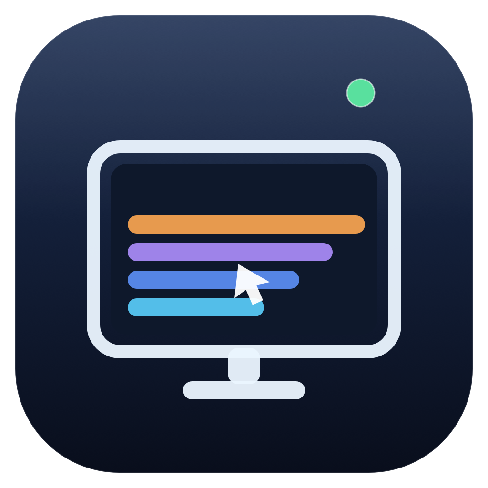

# ResSwitch

<p align="center">
  
</p>

常驻 macOS 菜单栏的**虚拟显示器分辨率切换工具**。默认 1920×1080，也可以一键切到 2K、4K、5K、iPad Pro 2018、MacBook Pro 16″ 或 3440×1440。

定位很简单：不接管物理显示器、不改系统设置、不联网；只在需要时创建一块虚拟屏，切换分辨率，然后随时关闭。


---

## 下载

- [GitHub Releases](https://github.com/liumin1128/ResSwitch/releases/latest)（推荐，下载最新 `ResSwitch-x.y.z.zip`）
- 或直接运行 `scripts/build-app.sh` 从源码构建

## 1.0.7 更新：英文界面，菜单精简

- 菜单栏界面全部改为英文，并去掉说明性文案：状态行只显示 `No virtual display` 或 `On · 3840×2160`，预设显示 `名称 · 分辨率`。
- 新增 **5K（5120×2880）** 预设；`Scale › 2×` 时逻辑尺寸为 2560×1440。
- 移除「打开显示器设置」「复制显示器信息」和 `About` 三个非核心菜单项；版本可用 `--version` 查看。
- 唯一屏幕的关闭/退出确认框缩短为一句后果说明。
- `--help`、`--list`、`--selftest` 输出同步改为英文。
- 版本号升至 1.0.7。

## 1.0.6 更新：原生 2× 默认，4K 可调大小

- 4K 默认改为 **原生 2×**：帧缓冲仍是 3840×2160（远程端 1:1 收到 4K），桌面逻辑尺寸为 1920×1080，UI 大小与原生 27″ 4K 屏的默认观感一致，不再“字小得看不清”。
- 4K 虚拟屏向 macOS 暴露多个 2× 观感尺寸：1920×1080（默认）、1680×945、1600×900、1440×810、1280×720。可在「系统设置 › 显示器」里直接调整，像原生 4K 屏一样。
  - 只有 1920×1080 这一档的帧缓冲是完整 3840×2160；选更小的观感尺寸时帧缓冲会同步变小（保持 1:1，不缩放、不糊）。
- 缩放菜单默认改为「原生 2×」；「点对点 1×」仍保留（3840 点桌面，适合想一次看到更多内容的人）。
- 1080p / 2K / Ultrawide 不支持 2×，仍按 1× 运行，行为不变。

## 1.0.5 修复

- 修复 **4K 点对点（3840×2160 1×）切不过去，一直弹“虚拟显示器未能上线”** 的问题。
  - 原因：macOS 26/27 会把 3840×2160 虚拟屏的默认模式强制设成 1920×1080；旧版给 4K 点对点声明的是一块 35 英寸（110 PPI）面板，1920×1080 在它上面只有 55 DPI，低于系统上线所需的约 72 DPI，WindowServer 干脆不把这块屏上线。
  - 现在 4K 点对点把面板宽度声明在 macOS 能接受的范围（≤600 mm），屏幕可以正常上线；随后由 App 启动一个短生命周期子进程，用公开的 `CGConfigureDisplayWithDisplayMode` 把模式显式切到 3840×2160，并回读确认。
  - 为什么不在主进程里切：macOS 26/27 里，进程如果在创建虚拟屏之前已经查询过显示器，就再也读不到这块新屏的模式列表；新起的子进程没有这个缓存问题。
- 切换成功的判定从“上线后 2.5 秒单次检查”改为“连续在线 0.6 秒 + 目标模式回读确认”；瞬时掉线会重试，不再直接报错。
- 4K 高清 2×、2K、iPad、MacBook Pro 16″、1080p 预设不受影响。
- 实测 macOS 27.2.1 / M5 Pro：4K 点对点创建后，独立进程读到 `3840×2160pt / 3840×2160px` 并保持稳定。

## 1.0.4 新增

- 新增 **1080p（1920×1080）** 预设，并设为**默认预设**（菜单第一项，带“默认”标记）。
- 启动 App 后菜单状态会提示“默认 1920×1080”；点一下即可创建。App 仍然不会在启动时自动建屏，避免多出一块屏。
- 1080p 只提供点对点 1×：逻辑 1920×1080 / 帧缓冲 1920×1080。
- 已实测创建后 WindowServer 模式为 1920×1080，UU 采集端读到 1920×1080、scale=1。

## 1.0.3 新增

- 新增 **MacBook Pro 16″（2021，M1 Pro/Max）** 内建屏预设：`3456×2234`。
- 点对点模式为 3456×2234 逻辑 / 3456×2234 像素；高清 2× 模式为 1728×1117 逻辑 / 3456×2234 像素。
- 已实测 macOS 27.2.1 上创建后默认就是 3456×2234 1×，UU 采集端读到的也是 3456×2234、scale=1。

## 1.0.2 更新：默认点对点

- 新增「缩放」菜单，默认 **点对点（1×）**：
  - 1080p → 1920×1080 逻辑 / 1920×1080 像素
  - 2K → 2560×1440 逻辑 / 2560×1440 像素
  - 4K → 3840×2160 逻辑 / 3840×2160 像素
  - iPad Pro 2018 → 2732×2048 逻辑 / 2732×2048 像素
  - MacBook Pro 16″ → 3456×2234 逻辑 / 3456×2234 像素
  - Ultrawide → 3440×1440 逻辑 / 3440×1440 像素
- 所有预设默认都是 1:1，远程端拿到多少像素，Mac 桌面就是多少点，不再默认给 4K / iPad 加 2×。
- 需要更大的 UI 时，可在「缩放」里切到 **高清 2×（4K / iPad / MBP 16）**；这时 4K 会变成逻辑 1920×1080 + 3840×2160 帧缓冲；iPad / MacBook Pro 16 同理。
- 保留 1.0.1 的 2K / 3440 PPI 修复，macOS 不会再默认选 1280×720。

> **关于 UU 远程**：如果 UU 的画面分辨率设置为 1080p，它会在约 0.3 秒内把主屏强制改回 1920×1080，即使 ResSwitch 刚把主屏设成 4K。日志中可以清楚看到 `3840×2160 → 1920×1080` 的回写。想让 4K 点对点生效，UU 的画质/分辨率也必须设为 4K（或“原画”），并且控制端本身是 4K。如果控制端是 2K，就用 2K 预设 + UU 2K，4K 不可能在 2K 控制端上点对点。

## 功能

- 菜单栏常驻，无 Dock 图标
- 七个内置预设，点击即切换
- 默认 `Scale › 2×`（原生 2×）：4K 帧缓冲 3840×2160、桌面 looks like 1920×1080，UI 大小和原生 4K 一致；也保留点对点 1×
- 4K 可以在系统显示器设置里调整观感大小（多档 2×），像原生 4K 屏
- 远程客户端拿到多少像素，虚拟屏帧缓冲就是多少像素（2× 时逻辑尺寸减半，像素仍 1:1）
- 显示当前虚拟屏状态，当前预设打勾
- 一键关闭虚拟屏；退出 App 也会自动释放
- 唯一屏幕保护：当虚拟屏是系统唯一的在线显示器时，关闭/退出会先二次确认；瞬时掉线不会释放唯一屏
- 不会修改物理显示器的分辨率，也不会关闭物理屏
- 提供 `--list` 只读诊断和 `--selftest` 自检命令

## 预设

默认 `Scale › 2×`（4K / 5K / iPad / MacBook Pro 16″）：

| 菜单项 | 物理像素 | 逻辑尺寸 | 缩放 |
| --- | ---: | ---: | --- |
| 4K | 3840×2160 | 1920×1080 | 2× HiDPI，可调大小 |
| 5K | 5120×2880 | 2560×1440 | 2× HiDPI |
| iPad Pro 2018 | 2732×2048 | 1366×1024 | 2× HiDPI |
| MacBook Pro 16″ | 3456×2234 | 1728×1117 | 2× HiDPI |
| 1080p | 1920×1080 | 1920×1080 | 1× |
| 2K | 2560×1440 | 2560×1440 | 1× |
| Ultrawide | 3440×1440 | 3440×1440 | 1× |

> 4K 默认是一块“looks like 1920×1080”的原生 2× 屏：帧缓冲仍是 3840×2160，远程端 1:1 收到 4K；桌面 UI 大小与原生 27″ 4K 屏一致。
>
> 也可以在「系统设置 › 显示器」里把 4K 的观感尺寸改成 1680×945、1600×900、1440×810、1280×720。它们同样是 2×，只是帧缓冲会相应变小（保持 1:1，不缩放）。

切到 `Scale › 1×` 后，所有预设都按 1:1 点对点运行：

| 菜单项 | 物理像素 | 逻辑尺寸 | 缩放 |
| --- | ---: | ---: | --- |
| 1080p | 1920×1080 | 1920×1080 | 1× |
| 2K | 2560×1440 | 2560×1440 | 1× |
| 4K | 3840×2160 | 3840×2160 | 1× |
| 5K | 5120×2880 | 5120×2880 | 1× |
| iPad Pro 2018 | 2732×2048 | 2732×2048 | 1× |
| MacBook Pro 16″ | 3456×2234 | 3456×2234 | 1× |
| Ultrawide | 3440×1440 | 3440×1440 | 1× |

> 预设语义是**匹配客户端像素**：虚拟屏的帧缓冲就是表中“物理像素”，远程端按这个尺寸推流时画面刚好铺满。
>
> 2K 这里指 QHD 2560×1440；严格意义上的 DCI 2K 是 2048×1080，但日常语境通常指前者。

## 安装

1. 解压 `ResSwitch-1.0.7.zip`
2. 把 `ResSwitch.app` 拖进「应用程序」文件夹
3. 双击打开

App 使用 ad-hoc 签名，没有经过 Apple 公证。如果系统提示“无法验证开发者”或“已损坏”，任选一种方式放行：

**方式一：系统设置**

1. 先双击一次，看到提示后点「完成」
2. 打开「系统设置 › 隐私与安全性」
3. 在“安全性”区域找到 ResSwitch，点「仍要打开」

**方式二：终端**

```bash
xattr -dr com.apple.quarantine "/Applications/ResSwitch.app"
```

## 使用

1. 打开 ResSwitch，菜单栏会出现一个显示器图标
2. 点图标，选择任意预设
3. 等待 2–4 秒，虚拟屏创建完成，菜单里会出现勾选
4. 再点其他预设即可切换分辨率
5. 点 `Close Virtual Display` 可释放虚拟屏；退出 App 也会自动释放
6. 如果这块虚拟屏是当前唯一的屏幕，关闭或退出前会先弹出确认，避免把远程画面关掉

启动 App 本身**不会**立刻创建虚拟屏，避免每次登录都多出一块屏；第一次点预设时才创建。

菜单结构：

```text
On · 3840×2160
────────────────────────
    1080p · 1920×1080
    2K · 2560×1440
  ✓ 4K · 3840×2160
    5K · 5120×2880
    iPad Pro 2018 · 2732×2048
    MacBook Pro 16″ · 3456×2234
    Ultrawide · 3440×1440
────────────────────────
Scale
    1×
  ✓ 2×
────────────────────────
Close Virtual Display
────────────────────────
Quit ResSwitch
```

> ResSwitch 管理的是**自己创建的虚拟屏**（名称形如 `ResSwitch · 4K`）。它不会修改物理显示器的分辨率，也不会去改别的软件已经创建的虚拟屏。

如果同时接着物理显示器，新的虚拟屏会出现在系统显示器设置里。你可以在「系统设置 › 显示器」中调整它的排列位置。

### 配合远程工具使用

ResSwitch 创建的是标准的 macOS 虚拟显示器，远程工具（如 UU 远程、Sunshine、Moonlight 等）只要支持多显示器，就能在它的显示器列表里看到：

- `ResSwitch · 1080p`
- `ResSwitch · 2K`
- `ResSwitch · 4K`
- `ResSwitch · 5K`
- `ResSwitch · iPad Pro 2018`
- `ResSwitch · MacBook Pro 16″`
- `ResSwitch · Ultrawide`

在远程端选择对应的虚拟屏即可。

> **UU 远程用户注意**：UU 被控端自己也会维护一块虚拟屏。当 ResSwitch 新建虚拟屏时，UU 可能检测到显示拓扑变化并重建自己的虚拟屏，远程画面会短暂闪烁或重连，这是正常的。等 UU 恢复后，在它的显示器列表里选择 `ResSwitch · …` 即可。建议先切好分辨率，再开始远程会话，体验更稳。

## 常见问题

### 点预设后没有反应 / 提示“虚拟显示器未能上线”

> 1.0.5 已修复 4K 点对点的这个问题。如果仍遇到，先确认版本是 1.0.5 或更新。

1. 等 5 秒再试一次
2. 完全退出 ResSwitch（菜单 › `Quit ResSwitch`），重新打开
3. 打开「系统设置 › 显示器」，确认是否出现 `ResSwitch · …`
4. 如果系统显示器设置卡住、所有显示操作都超时，请重启 Mac。不要连续反复点击切换

### 为什么 UU 里 4K 还是不点对点？

先确认 UU 自己的推流分辨率。实测 UU 会在约 0.3 秒内把主屏从 3840×2160 强制改回 1920×1080：

```text
14:26:25.339  Display Mode 10  [3840 x 2160]
14:26:25.641  Display Mode 9   [1920 x 1080]   ← UU 回写
```

也就是说，即使 ResSwitch 已经把虚拟屏建成 4K 点对点，只要 UU 的画质/分辨率还是 1080p，它会立刻覆盖掉。解决方式：

1. 在 UU 控制端的「画质 / 分辨率」里选 4K 或「原画」，再让 ResSwitch 用 4K 点对点
2. 如果控制端是 2K，就用 ResSwitch 2K + UU 2K；4K 不可能在 2K 控制端上点对点
3. 如果 UU 只能推 1080p，那 4K 点对点无法实现，这是 UU 的限制，不是 ResSwitch 没设对

### 切换分辨率时画面闪一下、窗口位置变了

正常。切换实现是“新建目标分辨率的虚拟屏 → 等它稳定 → 释放旧的虚拟屏”。显示拓扑变化时，macOS 会重新排列窗口，远程画面也可能闪一下。

### 虚拟屏没有变成主屏

ResSwitch 不会主动修改主屏，避免影响你本地的窗口布局。如果原来的主屏在创建虚拟屏时消失（例如 UU 重建自己的虚拟屏），macOS 可能自动把新虚拟屏设为主屏。你可以在「系统设置 › 显示器」里拖动排列，或把它设为主显示器。

### 休眠/唤醒后虚拟屏不见了

macOS 在睡眠/唤醒时可能重建显示拓扑。唤醒后打开菜单，如果状态显示“未启用”，重新点一次预设即可。当前版本不会在唤醒后自动重建。

### 支持 Intel Mac 吗？

代码使用公开的 AppKit/CoreGraphics 接口和 macOS 私有 `CGVirtualDisplay` 类，理论上 Intel 也可用，但只在 Apple Silicon + macOS 27.2.1 上实测。构建产物是 arm64。

### 会上传数据吗？

不会。App 不联网、不请求辅助功能/屏幕录制权限、不收集任何信息。

## 技术说明

- 使用私有 `CGVirtualDisplay` 系列类创建虚拟显示器，和 BetterDisplay、DeskPad、SideScreen、FluffyDisplay 使用的是同一套接口
- `hiDPI=true` 时：`maxPixels = 客户端像素`，mode 设为 `客户端像素 / 2`
- `hiDPI=false` 时：mode 等于客户端像素
- 每次切换先创建新虚拟屏，等待上线并稳定至少 2.5 秒，再显式应用目标模式并回读确认，最后释放旧虚拟屏
- 4K 点对点上线后，会用短生命周期子进程（`--set-mode`）应用 3840×2160 模式；这是为了绕开 macOS 26/27 “主进程读不到自己新建虚拟屏模式列表”的限制
- 释放过早可能让 WindowServer 的显示配置卡死，所以代码里做了最小存活时间保护
- 退出 App 时会等新屏稳定后再释放，但等待有上限（普通退出 8 秒、系统关机 3 秒），不会无限挂起
- 系统关机/注销时不弹确认（避免阻塞关机），最多等待 3 秒；菜单/Cmd+Q 的普通退出仍会确认
- 唯一屏保护：关闭虚拟屏、退出、以及掉线确认都会检查是否还有其他在线显示器；唯一屏不会被静默释放
- 唯一屏瞬时掉线只保留状态、不释放对象；如果它真的消失，重新点一次预设即可重建
- 不调用 `CGSConfigureDisplayEnabled`，不碰物理屏开关，避免显示链路风险

### 已知限制

- 依赖 macOS 私有 API，未来系统更新可能失效
- 切换是重建虚拟屏，不是原地改 mode，因此会有一次显示拓扑变化
- 每块虚拟屏只给一个模式；连续快速切换会排队/提示“正在切换”
- 不处理睡眠唤醒后的自动恢复
- 不设置主屏、不关闭物理屏、不修改物理屏分辨率
- 没有登录时自动启动（v1 保持简单）
- **无头部署风险**：如果这台 Mac 没有物理屏，ResSwitch 的虚拟屏就是唯一屏幕。退出/关闭后系统将没有画面，App 无法在进程退出后保持虚拟屏。请确保有物理屏、UU 自身虚拟屏或 SSH 等恢复手段；安装新版本前也请先准备好备用显示通道。

## 构建

需要 macOS 13+、Command Line Tools（含 Swift 5.9+），不需要完整 Xcode。

```bash
cd ResSwitch
./scripts/build-app.sh
```

产物：

```text
dist/ResSwitch.app
dist/ResSwitch-1.0.7.zip
```

手动构建：

```bash
swift build -c release --product ResSwitch
```

### 诊断

只读列出当前显示器与模式，不会创建任何虚拟屏：

```bash
./dist/ResSwitch.app/Contents/MacOS/ResSwitch --version
./dist/ResSwitch.app/Contents/MacOS/ResSwitch --list
```

创建一块默认 1080p 虚拟屏，等待稳定后自动释放：

```bash
./dist/ResSwitch.app/Contents/MacOS/ResSwitch --selftest 1080p
./dist/ResSwitch.app/Contents/MacOS/ResSwitch --selftest ipad
./dist/ResSwitch.app/Contents/MacOS/ResSwitch --selftest mbp16
./dist/ResSwitch.app/Contents/MacOS/ResSwitch --selftest 5k
```

连续切换 iPad → 4K 再释放（会改变显示拓扑，谨慎使用）：

```bash
./dist/ResSwitch.app/Contents/MacOS/ResSwitch --selftest-switch
```

> 自检命令适合排查问题。运行前保存工作，并确保旁边有人可以恢复显示。不要在显示链路已经不稳定时反复执行。

## 项目结构

```text
ResSwitch/
├── Package.swift
├── Sources/
│   ├── CGVirtualDisplayBridge/      # 私有 Objective-C 类声明
│   └── ResSwitch/
│       ├── main.swift               # 入口、--list、--selftest
│       ├── AppDelegate.swift        # 菜单栏菜单与交互
│       ├── VirtualDisplayController.swift
│       ├── Preset.swift
│       └── DisplayInfo.swift
├── Resources/
│   ├── Info.plist
│   ├── AppIcon.icns
│   └── AppIcon-1024.png
├── scripts/
│   ├── build-app.sh
│   └── make-icon.swift
├── dist/
│   ├── ResSwitch.app
│   └── ResSwitch-1.0.7.zip
└── README.md
```

## 卸载

1. 菜单里点 `Quit ResSwitch`
2. 把 `ResSwitch.app` 从「应用程序」移到废纸篓
3. 可选：删除偏好设置

```bash
defaults delete com.liumin.resswitch 2>/dev/null || true
```

## 参考

实现时参考了这些公开项目对 `CGVirtualDisplay` 私有接口的用法：

- [displayoverride-mac](https://github.com/domdomegg/displayoverride-mac)：菜单栏 + 多分辨率虚拟屏
- [hidpify DESIGN.md](https://github.com/raeseoklee/hidpify/blob/main/DESIGN.md)：`CGVirtualDisplay` / HiDPI 行为说明
- [DeskPad](https://github.com/Stengo/DeskPad)：多模式虚拟屏与 `CGDisplayStream`

## License

个人使用项目，未附开源许可证。使用私有 API 的风险由使用者自行承担。
